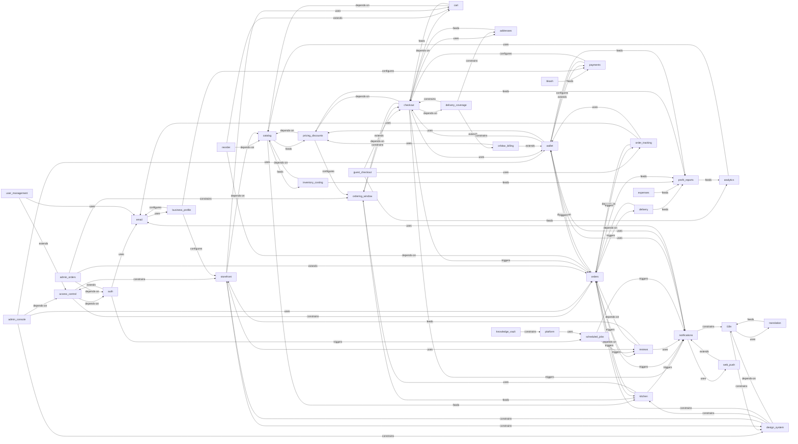

# Vault index

> Generated by `node vault/tools/vault.mjs build`. Do not edit by hand; edit the node files.

## Nodes

| Node | Kind | Status | Rules | Decisions | Open Qs | Ideas | Reviewed |
|---|---|---|---|---|---|---|---|
| [Roles & access control](nodes/access-control.md) `access-control` | cross-cutting | live | 5 | 2 | 0 | 1 | 2026-10-21 |
| [Address book](nodes/addresses.md) `addresses` | feature | live | 2 | 1 | 0 | 1 | 2026-10-21 |
| [Admin console (shell & dashboard)](nodes/admin-console.md) `admin-console` | feature | live | 4 | 2 | 0 | 2 | 2026-10-21 |
| [Orders on a customer's behalf](nodes/admin-orders.md) `admin-orders` | feature | live | 3 | 2 | 0 | 1 | 2026-10-21 |
| [Analytics](nodes/analytics.md) `analytics` | feature | live | 2 | 1 | 0 | 1 | 2026-10-21 |
| [Accounts & sign-in (Google only)](nodes/auth.md) `auth` | feature | live | 7 | 4 | 0 | 2 | 2026-10-21 |
| [bKash online payment](nodes/bkash.md) `bkash` | integration | deprecated | 1 | 3 | 0 | 1 | 2026-10-21 |
| [Business identity & profile](nodes/business-profile.md) `business-profile` | feature | live | 3 | 1 | 0 | 1 | 2026-10-21 |
| [Cart](nodes/cart.md) `cart` | feature | live | 2 | 1 | 0 | 1 | 2026-10-21 |
| [Product catalog](nodes/catalog.md) `catalog` | feature | live | 4 | 1 | 0 | 2 | 2026-10-21 |
| [Checkout](nodes/checkout.md) `checkout` | feature | live | 6 | 2 | 0 | 2 | 2026-10-21 |
| [Delivery coverage areas](nodes/delivery-coverage.md) `delivery-coverage` | feature | live | 3 | 1 | 0 | 2 | 2026-10-21 |
| [Delivery](nodes/delivery.md) `delivery` | feature | partial | 5 | 2 | 0 | 1 | 2026-10-21 |
| [Design system (Glossy Glass)](nodes/design-system.md) `design-system` | cross-cutting | live | 16 | 12 | 0 | 5 | 2026-10-21 |
| [Transactional email](nodes/email.md) `email` | integration | live | 4 | 1 | 0 | 1 | 2026-10-21 |
| [Business expenses](nodes/expenses.md) `expenses` | feature | live | 2 | 1 | 0 | 1 | 2026-10-21 |
| [Guest checkout](nodes/guest-checkout.md) `guest-checkout` | feature | live | 3 | 3 | 0 | 1 | 2026-10-21 |
| [Bilingual UI (Bangla / English)](nodes/i18n.md) `i18n` | cross-cutting | live | 6 | 1 | 0 | 1 | 2026-10-21 |
| [Inventory & product costing](nodes/inventory-costing.md) `inventory-costing` | feature | live | 4 | 1 | 0 | 1 | 2026-10-21 |
| [Kitchen production board](nodes/kitchen.md) `kitchen` | feature | live | 5 | 2 | 0 | 2 | 2026-10-21 |
| [Knowledge vault (this graph)](nodes/knowledge-vault.md) `knowledge-vault` | meta | live | 9 | 3 | 0 | 3 | 2026-10-21 |
| [In-app notifications](nodes/notifications.md) `notifications` | feature | live | 3 | 1 | 0 | 1 | 2026-10-21 |
| [Orbitax corporate billing](nodes/orbitax-billing.md) `orbitax-billing` | feature | deprecated | 2 | 2 | 0 | 0 | 2026-10-21 |
| [Order tracking](nodes/order-tracking.md) `order-tracking` | feature | live | 4 | 2 | 0 | 1 | 2026-10-21 |
| [Advance-order window & time slots](nodes/ordering-window.md) `ordering-window` | feature | live | 5 | 1 | 0 | 2 | 2026-10-21 |
| [Order lifecycle](nodes/orders.md) `orders` | feature | live | 9 | 5 | 0 | 1 | 2026-10-21 |
| [Payment methods & accounts](nodes/payments.md) `payments` | feature | live | 5 | 3 | 0 | 1 | 2026-10-21 |
| [Platform & architecture](nodes/platform.md) `platform` | cross-cutting | live | 9 | 2 | 0 | 2 | 2026-10-21 |
| [Pricing, discounts & coupons](nodes/pricing-discounts.md) `pricing-discounts` | feature | live | 5 | 2 | 0 | 1 | 2026-10-21 |
| [Profit & reports](nodes/profit-reports.md) `profit-reports` | feature | live | 4 | 1 | 0 | 1 | 2026-10-21 |
| [Order again](nodes/reorder.md) `reorder` | feature | live | 3 | 1 | 0 | 1 | 2026-10-21 |
| [Reviews & ratings](nodes/reviews.md) `reviews` | feature | live | 4 | 1 | 0 | 2 | 2026-10-21 |
| [Scheduled housekeeping](nodes/scheduled-jobs.md) `scheduled-jobs` | cross-cutting | live | 2 | 1 | 0 | 1 | 2026-10-21 |
| [Storefront (home, menu, contact)](nodes/storefront.md) `storefront` | feature | live | 5 | 3 | 0 | 3 | 2026-10-21 |
| [Machine-translation fallback](nodes/translation.md) `translation` | integration | live | 2 | 1 | 0 | 1 | 2026-10-21 |
| [User management (admin)](nodes/user-management.md) `user-management` | feature | live | 2 | 2 | 0 | 1 | 2026-10-21 |
| [Wallet (platform-wide ledger)](nodes/wallet.md) `wallet` | feature | live | 10 | 8 | 0 | 4 | 2026-10-21 |
| [Web Push (phone notifications)](nodes/web-push.md) `web-push` | integration | live | 3 | 1 | 0 | 1 | 2026-10-21 |

## Relations

## Waiting on the user

- **D-ADM-002** (proposed decision, [admin-console](nodes/admin-console.md)) Group the admin screens as Orders (all, new, deliveries), Money (wallets & payments, reports & profit, expenses), Menu (products, categories, coupons & promos), Stock (materials, purchases, costing), Insights (analytics) and Settings (ordering & wallet, business profile, users).
- **D-ORD-004** (proposed decision, [orders](nodes/orders.md)) With the wallet, cancelling no longer requires refunding first. The charge is reversed and paid money stays as credit, so customers may cancel a pending order even after paying. This rewrote R-ORD-003, R-ORD-004 and R-ORD-005, and pay-first confirmation is now automatic (R-ORD-002).
- **D-ORD-005** (proposed decision, [orders](nodes/orders.md)) Admins may dispatch straight from CONFIRMED (skipping Preparing) when nothing needs cooking, and the manual "set payment status" endpoint is removed (R-ORD-009).
- **D-WAL-006** (proposed decision, [wallet](nodes/wallet.md)) Store the wallet as one signed `WalletEntry` ledger that replaces the `Payment` table. The migration converts old payments (SUCCESS → confirmed, PENDING → pending claim, FAILED/VOID → rejected, REFUNDED → debit adjustment), posts charges for orders that were owed, and credits orders that an admin had marked PAID by hand.
- **D-WAL-007** (proposed decision, [wallet](nodes/wallet.md)) Settlement rule: payments linked to an order cover that order first, plus any *free* positive credit. Existing pay-later debt does not block a pay-first order the customer has paid for.
- **D-WAL-008** (proposed decision, [wallet](nodes/wallet.md)) A COD order collected short at the door leaves the shortfall as wallet debt for an account, or PARTIALLY_PAID for a guest.

## Must-rules

- **R-ACL-001** ([access-control](nodes/access-control.md)) Access is decided by role, never by ownership percentage or partner record.
- **R-ACL-002** ([access-control](nodes/access-control.md)) A first Google sign-in (the only public sign-up) always creates a CUSTOMER. ADMIN and KITCHEN accounts are created only by the seed (`SEED_ADMIN_EMAIL` / `SEED_KITCHEN_EMAIL`) or by an admin (see user-management), and their owners sign in with Google on that email.
- **R-ACL-003** ([access-control](nodes/access-control.md)) Every role check is enforced on the server (`requireRole`). Client route guards only shape navigation; they are not security.
- **R-ACL-004** ([access-control](nodes/access-control.md)) Staff (ADMIN/KITCHEN) who open cart, checkout or customer-only pages are sent to their own dashboard. Storefront browsing pages are the exception: an admin sees them in preview mode, under a banner that leads back to the dashboard.
- **R-ACL-005** ([access-control](nodes/access-control.md)) Public tracking links (`/track/:token`) open for anyone, staff included, without logging in.
- **R-ADR-001** ([addresses](nodes/addresses.md)) Customers see and edit only their own addresses.
- **R-ADR-002** ([addresses](nodes/addresses.md)) Orders snapshot address fields (see R-CHK-003). Address edits never touch existing orders.
- **R-ADM-001** ([admin-console](nodes/admin-console.md)) Admin navigation lives in the sidebar sections, not the shared header. A new admin page gets a sidebar entry in the right section, not a new top-level group.
- **R-ADM-002** ([admin-console](nodes/admin-console.md)) Badges and dashboard counts come from `GET /api/admin/overview` (one query set), polled. Pages don't invent their own counts.
- **R-ADM-004** ([admin-console](nodes/admin-console.md)) The language switch stays visible in the admin top bar at every width (R-I18N-001).
- **R-ADO-001** ([admin-orders](nodes/admin-orders.md)) Admin orders record `placedById`, the admin's footprint.
- **R-ADO-002** ([admin-orders](nodes/admin-orders.md)) Admin orders have no cutoff and no slot restriction. Only past dates are rejected.
- **R-ADO-003** ([admin-orders](nodes/admin-orders.md)) The customer's notification waits in their inbox, and a placeholder account sees it once claimed.
- **R-ANL-001** ([analytics](nodes/analytics.md)) Guest orders are grouped under one "Guest" bucket in customer analytics.
- **R-AUTH-001** ([auth](nodes/auth.md)) Sign-in is Google only, for every role. There are no register, password-login, email-code or password-reset endpoints or pages. Re-adding any of them needs the owner's decision.
- **R-AUTH-002** ([auth](nodes/auth.md)) A placeholder account is never deleted. A Google sign-in for its email takes it over with all its orders, and clears `isPlaceholder`.
- **R-AUTH-003** ([auth](nodes/auth.md)) A Google sign-in for an existing email logs into that account without changing its role, and confirms it (`emailVerifiedAt`) if it was unconfirmed. A new email creates a confirmed CUSTOMER immediately and claims guest orders placed with that email.
- **R-AUTH-004** ([auth](nodes/auth.md)) `POST /api/auth/google` is throttled per IP (30 per 5 minutes), fail-open. Google accounts whose email Google hasn't verified are refused.
- **R-AUTH-005** ([auth](nodes/auth.md)) The cleanup job deletes only legacy *self-registered* accounts that never confirmed (`createdById` null). It never deletes admin-created accounts, which stay unconfirmed until their owner's first Google sign-in, and never deletes placeholders.
- **R-AUTH-007** ([auth](nodes/auth.md)) Sign-in requires `GOOGLE_CLIENT_ID` (server) and `VITE_GOOGLE_CLIENT_ID` (client), set to the same OAuth client. Without them the sign-in page explains it isn't set up, and guest checkout keeps working.
- **R-BKS-001** ([bkash](nodes/bkash.md)) No online bKash flow until the owner has a merchant account and decides to add it back. If it returns, it must record payments as wallet entries, idempotently.
- **R-BIZ-001** ([business-profile](nodes/business-profile.md)) Business identity is never hard-coded in components. Read it from `useBusinessProfile()`, whose defaults live in `config/businessProfile.ts`.
- **R-BIZ-002** ([business-profile](nodes/business-profile.md)) Currency is BDT and the business timezone is Asia/Dhaka (a fixed UTC+6 offset with no DST). Date logic relies on this.
- **R-CART-001** ([cart](nodes/cart.md)) Prices shown in the cart are a preview. The server re-prices every line at checkout from current product data.
- **R-CAT-001** ([catalog](nodes/catalog.md)) A price change appends a `ProductPriceHistory` row. Past orders keep their captured prices and are never re-priced.
- **R-CAT-002** ([catalog](nodes/catalog.md)) A sale price applies only when it is below the list price. The reduction is recorded as a food discount on each order line.
- **R-CAT-003** ([catalog](nodes/catalog.md)) `isActive = false` hides a product everywhere public. `isAvailable = false` keeps it visible but not orderable.
- **R-CHK-001** ([checkout](nodes/checkout.md)) The server validates the date, slot, area and every price, and is authoritative. Client totals are previews.
- **R-CHK-002** ([checkout](nodes/checkout.md)) Each order line captures the product name, list price, charged unit price and line total at order time.
- **R-CHK-003** ([checkout](nodes/checkout.md)) The address is snapshotted onto the order. Editing or deleting the saved address never changes past orders.
- **R-CHK-004** ([checkout](nodes/checkout.md)) A missing phone number is captured at checkout and saved back to the profile and address.
- **R-CHK-006** ([checkout](nodes/checkout.md)) Pay later is offered only to signed-in customers and only when the order fits their available limit. The server re-checks (R-WAL-004).
- **R-COV-001** ([delivery-coverage](nodes/delivery-coverage.md)) The server refuses any order whose area is outside coverage. The client warns early, but the server decides.
- **R-COV-002** ([delivery-coverage](nodes/delivery-coverage.md)) `server/src/modules/orders/delivery-areas.ts` is the single source of truth, and `client/src/lib/deliveryAreas.ts` mirrors it. Change both together.
- **R-COV-003** ([delivery-coverage](nodes/delivery-coverage.md)) Orbitax (`orbitax.com`) accounts may also order to the Mohakhali office area.
- **R-DLV-001** ([delivery](nodes/delivery.md)) There are exactly two cost values: `customerDeliveryCost` (net of any delivery discount) and `actualDeliveryCost` (entered later). There is deliberately no estimated delivery cost.
- **R-DLV-002** ([delivery](nodes/delivery.md)) The difference (customer − actual) is derived and never stored. It is null until the actual cost is entered.
- **R-DLV-003** ([delivery](nodes/delivery.md)) Customers see delivery status, provider and tracking, never any cost detail.
- **R-DLV-005** ([delivery](nodes/delivery.md)) The delivery record has no status of its own. Where an order is comes only from `Order.status`.
- **R-DSN-001** ([design-system](nodes/design-system.md)) No component hard-codes a colour. Colours come from `styles/tokens.css` or the generated `styles/palettes.css`, and `npm run check:design` must pass.
- **R-DSN-002** ([design-system](nodes/design-system.md)) Palettes are changed only in `client/scripts/palettes.mjs`, then regenerated with `npm run palettes`. Never edit `palettes.css` or `palettes.gen.ts` by hand.
- **R-DSN-003** ([design-system](nodes/design-system.md)) Every palette in both modes passes the contrast minimums: body text ≥14:1, accent-ink ≥5.6 (light) / ≥7.8 (dark), h-grad stops ≥4.6, on-accent on btn-grad ≥4.8, focus accent ≥3.5.
- **R-DSN-004** ([design-system](nodes/design-system.md)) Text never sits on `--grad`. Gradient text uses `--h-grad` on the text element itself. Text on `--btn-grad` uses `--on-accent`.
- **R-DSN-005** ([design-system](nodes/design-system.md)) Status colours (success, warning, danger, info) mean status only, never change with the palette, and always come with an icon and a text label.
- **R-DSN-006** ([design-system](nodes/design-system.md)) Bangla text is never letter-spaced. Bangla body text is 17px / 1.78.
- **R-DSN-007** ([design-system](nodes/design-system.md)) Theme, palette and language are applied before first paint by the inline script in `client/index.html`, using the `chaya-theme`, `chaya-palette` (a palette id or `random`), `chaya-palette-random` (the current random pick and its expiry) and `chaya-lang` keys. Changing a key means changing both places. The script's palette-id list is injected by `npm run palettes`.
- **R-DSN-008** ([design-system](nodes/design-system.md)) Animate only transform, opacity and clip-path. Honour `prefers-reduced-motion` and `html.low-motion`. Never leave first-paint content at opacity 0.
- **R-DSN-009** ([design-system](nodes/design-system.md)) Glass falls back to `--glass-solid` without backdrop-filter or under low-motion. Popovers and menus use `--popover-bg` so text behind them never bleeds through.
- **R-DSN-010** ([design-system](nodes/design-system.md)) Touch targets are ≥48px, focus rings are visible (2px accent, 2px offset), and there is no horizontal scroll at 360px.
- **R-DSN-011** ([design-system](nodes/design-system.md)) Printed documents (invoice, receipt) are always a clean white sheet, using the `--print-*` tokens.
- **R-DSN-014** ([design-system](nodes/design-system.md)) Random mode never swaps the palette while the tab is hidden, while the user is typing in a field, or while the palette picker is open. Automatic swaps use the soft crossfade (not the circular reveal), are instant under reduced motion, keep the same pick across reloads until its period ends, and stay in sync across open tabs.
- **R-DSN-015** ([design-system](nodes/design-system.md)) Appearance changes (theme, palette, language) take effect even when a View Transition does not run. `withViewTransition` applies the update directly if the browser hasn't run it within 400ms. State must never depend on an animation completing.
- **R-DSN-016** ([design-system](nodes/design-system.md)) Default palette preference for new visitors is **Random**. When the user picks a fixed palette instead, the default fixed palette is **Ember & Gold** (no `data-palette` attribute).
- **R-EML-001** ([email](nodes/email.md)) Every email has a plain-text body. HTML is optional.
- **R-EML-002** ([email](nodes/email.md)) Non-essential mail (for example review invites) carries a `List-Unsubscribe` header. All mail sets Reply-To.
- **R-EML-003** ([email](nodes/email.md)) A mail failure never breaks the business action that triggered it.
- **R-EXP-001** ([expenses](nodes/expenses.md)) Ingredient and packaging purchases are not expenses. They go through inventory (R-INV-002).
- **R-GST-001** ([guest-checkout](nodes/guest-checkout.md)) Guest orders have `customerId = null`. Contact details live in the address snapshot and the optional `guestEmail`.
- **R-GST-002** ([guest-checkout](nodes/guest-checkout.md)) Guest orders are skipped by the review-invite job, because there is no account to review from.
- **R-I18N-001** ([i18n](nodes/i18n.md)) Bangla (`bn`) is the default language. The switch is always visible in the header on every surface: customer, admin and kitchen.
- **R-I18N-002** ([i18n](nodes/i18n.md)) Every user-visible string has both a Bangla and an English variant: `t(bn, en)` in components, and bilingual message keys for notifications and emails.
- **R-I18N-003** ([i18n](nodes/i18n.md)) Admin content with an English twin is rendered with `tc` or `lc`. Show the active language's value when present, otherwise whichever exists. Never show an empty label.
- **R-I18N-004** ([i18n](nodes/i18n.md)) Notifications are stored as a message key plus params (with a Bangla fallback) so the bell renders in the reader's current language, not the language that was active when the notification was created.
- **R-I18N-006** ([i18n](nodes/i18n.md)) The language choice persists in localStorage and is mirrored into the i18n module during the same render, so plain helpers never lag one render behind.
- **R-INV-001** ([inventory-costing](nodes/inventory-costing.md)) Material cost is a weighted average updated on each purchase. No FIFO or LIFO.
- **R-INV-002** ([inventory-costing](nodes/inventory-costing.md)) Purchases of ingredients and packaging update inventory and are never recorded as expenses.
- **R-INV-003** ([inventory-costing](nodes/inventory-costing.md)) Every stock change writes an append-only `InventoryTransaction`.
- **R-INV-004** ([inventory-costing](nodes/inventory-costing.md)) Product cost is derived from the recipe and current average costs, never typed in.
- **R-KIT-001** ([kitchen](nodes/kitchen.md)) Only confirmed, non-cancelled orders (CONFIRMED, PREPARING) count toward production.
- **R-KIT-002** ([kitchen](nodes/kitchen.md)) Progress is tracked per order line (`OrderItem.kitchenStage`), never per aggregated product, so a new order never inherits another order's progress.
- **R-KIT-003** ([kitchen](nodes/kitchen.md)) Order status is derived from its lines: all TO_COOK → CONFIRMED, any progress → PREPARING. "Packed and ready to dispatch" is an explicit action on an order whose lines are all READY. It sets `Order.readyAt` (no status change) and is cleared automatically if a line is sent back.
- **R-KV-001** ([knowledge-vault](nodes/knowledge-vault.md)) Before changing code, an agent runs `vault.mjs brief` and `vault.mjs rules <files>` for the files it will touch, and reads the affected node files.
- **R-KV-002** ([knowledge-vault](nodes/knowledge-vault.md)) If a change would break a `[must]` rule, contradict a `confirmed` decision, settle an `open` question, or create a contradiction between rules, the agent stops and asks the user, quoting the ids involved, before acting.
- **R-KV-003** ([knowledge-vault](nodes/knowledge-vault.md)) Every clarification the user gives is recorded as a `confirmed` decision on the node it concerns, in the same change. A judgement call the user has not seen is recorded as `proposed`.
- **R-KV-004** ([knowledge-vault](nodes/knowledge-vault.md)) Rules are never deleted or rewritten silently. Every change to a rule comes with a decision that says what changed and why.
- **R-KV-005** ([knowledge-vault](nodes/knowledge-vault.md)) Entry ids are permanent. Never reuse or renumber them. Get new ones with `vault.mjs next-id`.
- **R-KV-006** ([knowledge-vault](nodes/knowledge-vault.md)) A new feature gets its own node, with edges to every feature it touches, in the same change that adds the feature.
- **R-KV-007** ([knowledge-vault](nodes/knowledge-vault.md)) `vault.mjs check` reports 0 errors, and `vault.mjs build` has been run, before work is committed.
- **R-NTF-001** ([notifications](nodes/notifications.md)) Notifications come only from real events in services, never from client-side guesses.
- **R-NTF-002** ([notifications](nodes/notifications.md)) Each notification stores a message key + params (plus a Bangla fallback title and body) and an optional in-app link.
- **R-ORB-001** ([orbitax-billing](nodes/orbitax-billing.md)) Orbitax perks (office area, auto coupon) are gated by email domain (`orbitax.com` or a subdomain), checked on the server.
- **R-TRK-001** ([order-tracking](nodes/order-tracking.md)) The tracking token is 192 random bits, created on first use, and unguessable.
- **R-TRK-002** ([order-tracking](nodes/order-tracking.md)) The public tracking page never shows the street address or phone number, in case the link is forwarded.
- **R-TRK-003** ([order-tracking](nodes/order-tracking.md)) The "order confirmed" email with the link is sent at most once per order, whether an admin confirmed it or full payment did, and a mail failure never blocks confirmation.
- **R-TRK-004** ([order-tracking](nodes/order-tracking.md)) The tracker never claims a step that hasn't happened, such as "Confirmed" before the order is confirmed. Payment is never a step of its own: it appears as the next action.
- **R-WIN-001** ([ordering-window](nodes/ordering-window.md)) The server computes the earliest allowed fulfillment date from the cutoff, the minimum advance days and the business timezone, and rejects earlier orders.
- **R-WIN-002** ([ordering-window](nodes/ordering-window.md)) The cutoff, minimum advance days and delivery charge come from `OrderingSetting`. Never hard-code them.
- **R-WIN-003** ([ordering-window](nodes/ordering-window.md)) Customers on weekdays (Sun–Thu) can only pick 12:00–14:00. On weekends (Fri–Sat) all slots 08:00–22:00 are open. Slots are stored as "HH:MM-HH:MM".
- **R-WIN-004** ([ordering-window](nodes/ordering-window.md)) Admin orders placed on a customer's behalf ignore the cutoff and slot limits. Only past dates are rejected (see admin-orders).
- **R-WIN-005** ([ordering-window](nodes/ordering-window.md)) The slot list is mirrored in `client/src/lib/slots.ts`. Keep it in sync with the server.
- **R-ORD-001** ([orders](nodes/orders.md)) Forward-only transitions: PENDING→{CONFIRMED,CANCELLED}, CONFIRMED→{PREPARING,OUT_FOR_DELIVERY,CANCELLED}, PREPARING→OUT_FOR_DELIVERY, OUT_FOR_DELIVERY→DELIVERED. DELIVERED and CANCELLED are terminal. There are exactly these six statuses for every role.
- **R-ORD-002** ([orders](nodes/orders.md)) A PAY_FIRST order cannot be confirmed by hand: it confirms itself when its payment settles (R-WAL-006). PAY_LATER and COD orders are confirmed by an admin.
- **R-ORD-003** ([orders](nodes/orders.md)) A customer can cancel their own order only while it is PENDING. Any wallet charge is reversed and money already paid stays as wallet credit. After that, the order page points them to `/contact`.
- **R-ORD-004** ([orders](nodes/orders.md)) An admin can cancel only from PENDING or CONFIRMED. Cancelling reverses the wallet charge (R-WAL-008).
- **R-ORD-005** ([orders](nodes/orders.md)) Once CANCELLED, the order is locked: no status or payment-method changes. Pending claims linked to it are still reviewed, and land as wallet credit.
- **R-ORD-006** ([orders](nodes/orders.md)) Order financial fields are captured at checkout and never recomputed from current product prices (historical immutability).
- **R-ORD-007** ([orders](nodes/orders.md)) `dispatchedAt` and `deliveredAt` are stamped on the first transition to OUT_FOR_DELIVERY and DELIVERED respectively, and only then.
- **R-ORD-009** ([orders](nodes/orders.md)) Order `paymentStatus` is derived by the wallet module (PENDING, PAID, ON_WALLET, PARTIALLY_PAID, REFUNDED). There is no endpoint to set it by hand.
- **R-PAY-001** ([payments](nodes/payments.md)) Unconfirmed claims never count toward what is paid (R-WAL-001).
- **R-PAY-002** ([payments](nodes/payments.md)) Order payment status, `amountPaid`, `amountDue` and `onWallet` are derived from the order's wallet entries. Never set them by hand.
- **R-PAY-003** ([payments](nodes/payments.md)) Money records are never deleted (R-WAL-002). Corrections are new entries with who, when and why.
- **R-PAY-004** ([payments](nodes/payments.md)) The three modes are PAY_FIRST, PAY_LATER and COD (guests: PAY_FIRST or COD). The mode can change only while the order is PENDING.
- **R-PAY-005** ([payments](nodes/payments.md)) There is no online payment gateway. The customer UI shows the business's accounts and a claim form, never a "pay online" button.
- **R-PLT-001** ([platform](nodes/platform.md)) New backend capability lives in its own module under `server/src/modules/<name>/` (routes → controller → service, with zod schemas) and is mounted in `server/src/routes.ts`.
- **R-PLT-002** ([platform](nodes/platform.md)) Routers that serve public endpoints are mounted before any router that mounts at `/` with a blanket `authenticate`. Otherwise the auth gate returns 401 for the public route (see the ordering comments in `routes.ts`).
- **R-PLT-003** ([platform](nodes/platform.md)) Schema changes go through a Prisma migration in `server/prisma/migrations/`. Never edit an applied migration.
- **R-PLT-004** ([platform](nodes/platform.md)) Money is `Decimal(10,2)` on the server, and every financial figure is computed on the server. The client only previews totals and never sends a price the server trusts.
- **R-PLT-005** ([platform](nodes/platform.md)) Admin-only endpoints live under `/api/admin/*` behind `requireRole('ADMIN')`. Kitchen endpoints live under `/api/kitchen` (KITCHEN + ADMIN).
- **R-PLT-009** ([platform](nodes/platform.md)) Secrets and integration credentials (`BKASH_*`, `VAPID_*`, SMTP, `CRON_SECRET`, Google client id) come from env vars. When one is missing, the feature falls back to a mock, log-only or hidden mode rather than crashing.
- **R-PRC-001** ([pricing-discounts](nodes/pricing-discounts.md)) Food discounts and delivery discounts are always kept separate, from the coupon definition through order fields to reports. Never merge them.
- **R-PRC-002** ([pricing-discounts](nodes/pricing-discounts.md)) Total = (subtotal − productDiscount) + deliveryCost − deliveryDiscount, computed on the server. Coupon discounts are previewed at checkout and recomputed on the server.
- **R-PRC-003** ([pricing-discounts](nodes/pricing-discounts.md)) A coupon's minimum is checked against the net food amount (after sale prices), not the gross subtotal.
- **R-PRC-004** ([pricing-discounts](nodes/pricing-discounts.md)) Totals are never negative. A discount is capped at the amount it discounts.
- **R-PRC-005** ([pricing-discounts](nodes/pricing-discounts.md)) WALLET_LIMIT coupons are not discounts. They can only be redeemed in the wallet (R-WAL-005), and checkout or preview refuses them.
- **R-RPT-001** ([profit-reports](nodes/profit-reports.md)) Product profitability excludes delivery. Delivery gain or loss is reported on its own.
- **R-RPT-002** ([profit-reports](nodes/profit-reports.md)) An order's contribution is marked incomplete while `actualDeliveryCost` is missing.
- **R-RPT-003** ([profit-reports](nodes/profit-reports.md)) Cancelled orders are excluded from sales and profit.
- **R-REO-001** ([reorder](nodes/reorder.md)) Reordering always uses today's prices and availability, never the old order's captured prices.
- **R-REO-002** ([reorder](nodes/reorder.md)) The customer is told which items were skipped and whether any price changed.
- **R-REO-003** ([reorder](nodes/reorder.md)) An existing cart is never silently overwritten. The customer picks replace or add.
- **R-REV-001** ([reviews](nodes/reviews.md)) Only the order's own customer can review, only once it is DELIVERED, and only products that order contains.
- **R-REV-002** ([reviews](nodes/reviews.md)) Reviews are immutable. There is at most one per (order, product) and one overall per order, and they are never updated.
- **R-REV-003** ([reviews](nodes/reviews.md)) The review invite is sent once per order, the day after delivery, and never for guest orders.
- **R-REV-004** ([reviews](nodes/reviews.md)) Ratings shown on products and the site come from product reviews only, not overall reviews.
- **R-OPS-001** ([scheduled-jobs](nodes/scheduled-jobs.md)) Every job is idempotent and safe to run repeatedly.
- **R-OPS-002** ([scheduled-jobs](nodes/scheduled-jobs.md)) The internal endpoint is disabled entirely when `CRON_SECRET` is unset, so it can never be triggered publicly.
- **R-SHOP-001** ([storefront](nodes/storefront.md)) Only real reviews are shown. Never display sample or dummy testimonials.
- **R-SHOP-002** ([storefront](nodes/storefront.md)) Sold-out (`isAvailable = false`) products stay visible with a "sold out" badge but cannot be added to the cart. Inactive products are not shown.
- **R-TRN-001** ([translation](nodes/translation.md)) Translation never throws and never blocks rendering. When it fails, the original text is shown.
- **R-USR-001** ([user-management](nodes/user-management.md)) Every admin-created account records `createdById`.
- **R-USR-002** ([user-management](nodes/user-management.md)) Admin-created accounts have no password. The new user is emailed to sign in with the Google account for that email, so the admin must enter a Google (Gmail or Workspace) address.
- **R-WAL-001** ([wallet](nodes/wallet.md)) The balance is the sum of CONFIRMED `WalletEntry` amounts (+ money in, − money owed). PENDING claims and REJECTED entries never count.
- **R-WAL-002** ([wallet](nodes/wallet.md)) Entries are never deleted or edited after review. Corrections are new ADJUSTMENT entries, so the timeline is a complete audit trail with who did what and when.
- **R-WAL-003** ([wallet](nodes/wallet.md)) Every claim and every admin adjustment carries a reference (trx id, bank ref, receipt). A reference already used by a pending or confirmed payment is refused.
- **R-WAL-004** ([wallet](nodes/wallet.md)) A pay-later order is accepted only if the balance after charging stays ≥ −(limit). The check runs under a per-customer row lock (`SELECT … FOR UPDATE`) so concurrent orders can't slip past it. A refused order leaves nothing behind.
- **R-WAL-005** ([wallet](nodes/wallet.md)) The limit is `OrderingSetting.walletCreditLimit` (default ৳100) plus active `WalletLimitGrant`s. Grants come only from WALLET_LIMIT promo codes, once per customer per code, and expire after the code's `limitDays`.
- **R-WAL-006** ([wallet](nodes/wallet.md)) A pay-first order settles (charge posted, PAID, auto-CONFIRMED) when the confirmed payments linked to it plus any free positive credit reach its total. Settlement runs after placement, claim confirmation, admin-recorded payments and positive adjustments.
- **R-WAL-007** ([wallet](nodes/wallet.md)) Cash on delivery: marking the order DELIVERED posts the charge and the cash collected. A shortfall stays on the wallet (ON_WALLET).
- **R-WAL-008** ([wallet](nodes/wallet.md)) Cancelling reverses the order's charge (ORDER_REFUND). Money already paid stays as wallet credit, which can be spent or paid back with a debit adjustment.
- **R-WAL-009** ([wallet](nodes/wallet.md)) Guests have no wallet: they pay first or cash on delivery. Their entries have no customer and move to the account when they sign in with Google on the same email.
- **R-PSH-001** ([web-push](nodes/web-push.md)) If `VAPID_*` is unset, push is hidden and nothing else breaks.
- **R-PSH-002** ([web-push](nodes/web-push.md)) `/push/public-key` is public and must be mounted before the blanket-auth routers (R-PLT-002).

## Idea backlog (best value first)

- **I-ADM-002** · impact:med · effort:S · [admin-console](nodes/admin-console.md) — Add a "today" kitchen-and-delivery timeline on the dashboard (orders by slot with their step) so the owner can plan the day's dispatches.
- **I-ADO-001** · impact:med · effort:S · [admin-orders](nodes/admin-orders.md) — Let an admin search customers by phone as well as by email when starting an order, since phone is what callers give.
- **I-AUTH-003** · impact:med · effort:S · [auth](nodes/auth.md) — Show Google One Tap (the small "Continue as …" prompt) on the cart page for signed-out visitors with items in the cart. Signing in there pre-fills checkout and unlocks tracking, with no extra page.
- **I-BKS-001** · impact:high · effort:M · [bkash](nodes/bkash.md) — When a merchant account exists, add bKash Tokenized Checkout back as an instant pay-first option that writes wallet entries, removing the manual review queue.
- **I-BIZ-001** · impact:med · effort:S · [business-profile](nodes/business-profile.md) — Add opening hours and a "kitchen closed today" switch to the profile, shown on the home page and checkout, so customers aren't surprised on holidays.
- **I-CHK-001** · impact:high · effort:M · [checkout](nodes/checkout.md) — Collapse checkout into a single-screen, three-step stepper (Address → When → Pay) with a sticky summary on mobile. Today it is one long form, and a progress cue reduces abandonment.
- **I-CHK-002** · impact:med · effort:S · [checkout](nodes/checkout.md) — Remember the last-used time slot and payment mode for returning customers and preselect them.
- **I-COV-001** · impact:med · effort:S · [delivery-coverage](nodes/delivery-coverage.md) — When an address is out of coverage, offer "Notify me when you deliver to <area>" and store the area. Those requests become demand data for choosing the next zone.
- **I-DLV-001** · impact:med · effort:S · [delivery](nodes/delivery.md) — Warn the admin on the dashboard about delivered orders still missing an actual delivery cost, since they make contribution reports incomplete.
- **I-DSN-001** · impact:med · effort:S · [design-system](nodes/design-system.md) — Use skeleton cards (`.skeleton`) instead of the "লোড হচ্ছে…" text on the product list and home page, which makes loading feel faster.
- **I-DSN-004** · impact:med · effort:S · [design-system](nodes/design-system.md) — Make Random time-aware: favour warm palettes (Ember, Golden Hour, Coral) in the evening ordering window before the 22:00 cutoff, and calmer ones (Sapphire, Fresh Mint) in the morning. This ties the look to the food rhythm of the day.
- **I-GST-001** · impact:high · effort:M · [guest-checkout](nodes/guest-checkout.md) — Also attach past guest orders by **phone** number. Same-email guest orders already move into the account on Google sign-in, but many guests type a phone without an email.
- **I-I18N-001** · impact:med · effort:S · [i18n](nodes/i18n.md) — Detect the browser's language on the very first visit and pre-select English for non-Bangla browsers, while keeping Bangla as the default for everyone else.
- **I-KIT-001** · impact:med · effort:S · [kitchen](nodes/kitchen.md) — Add a printable or "big screen" prep sheet for the day (per-product totals plus per-order packing slips with slot and notes).
- **I-KV-001** · impact:med · effort:S · [knowledge-vault](nodes/knowledge-vault.md) — Add a CI step (GitHub Action) that runs `vault.mjs check` on every PR, so a PR that edits a feature without updating its node is flagged.
- **I-NTF-001** · impact:med · effort:S · [notifications](nodes/notifications.md) — Group notifications by order in the bell ("CB-1042 · 3 updates"), so busy days don't push older orders out of the seven-item panel.
- **I-TRK-001** · impact:med · effort:S · [order-tracking](nodes/order-tracking.md) — Add "Add to calendar" (an .ics file with the delivery slot) on the tracking page and confirmation.
- **I-PAY-002** · impact:med · effort:S · [payments](nodes/payments.md) — Show a QR code for the bKash/Nagad number next to the copy buttons, so customers paying from a second phone can scan instead of typing.
- **I-PRC-001** · impact:med · effort:S · [pricing-discounts](nodes/pricing-discounts.md) — Show "Add ৳X more for free delivery" in the cart when an active FREE_DELIVERY coupon has a minimum the cart is close to.
- **I-RPT-001** · impact:med · effort:S · [profit-reports](nodes/profit-reports.md) — A weekly owner digest (email or push): orders, net profit, best seller, and any delivered orders missing delivery cost.
- **I-REO-001** · impact:med · effort:S · [reorder](nodes/reorder.md) — Show an "Order your usual" shortcut on the home page for signed-in customers with a previous delivered order.
- **I-SHOP-001** · impact:high · effort:M · [storefront](nodes/storefront.md) — Show "Order by 10 pm for tomorrow" with a live countdown on the home page and product pages, from the ordering-window cutoff. The advance-order model is unusual, and making the deadline visible both explains it and adds healthy urgency.
- **I-SHOP-002** · impact:med · effort:S · [storefront](nodes/storefront.md) — Add a sticky "View cart · ৳total" bar on mobile once the cart has items, so customers don't have to hunt for the header icon.
- **I-WAL-001** · impact:high · effort:M · [wallet](nodes/wallet.md) — Show the customer's balance and pay-later headroom on the cart page, before checkout, so pay later never comes as a surprise refusal.
- **I-WAL-002** · impact:med · effort:S · [wallet](nodes/wallet.md) — Remind customers with a balance owed (push and in-app) a day after delivery, with the amount and the copy-ready payment accounts.
- **I-PSH-001** · impact:med · effort:S · [web-push](nodes/web-push.md) — Prompt for push at the moment it is most valuable, right after an order is placed ("Get notified when it's on the way?"), instead of at sign-in.
- **I-ACL-001** · impact:med · effort:M · [access-control](nodes/access-control.md) — Add a DELIVERY_RIDER (or "packer") role that sees only today's packed orders and can mark them out for delivery or delivered from a phone. This takes routine status taps off the owner.
- **I-ADM-001** · impact:med · effort:M · [admin-console](nodes/admin-console.md) — Add a command palette (Ctrl+K) to jump to any order number, customer or screen.
- **I-ANL-001** · impact:med · effort:M · [analytics](nodes/analytics.md) — A "customers to win back" list: customers whose usual ordering gap has passed, with one-tap coupon creation for them.
- **I-CAT-001** · impact:med · effort:M · [catalog](nodes/catalog.md) — Add a daily stock limit per product ("only 12 left for tomorrow"). Homemade capacity is finite, and today sold-out is a manual all-or-nothing switch.
- **I-CAT-002** · impact:med · effort:M · [catalog](nodes/catalog.md) — Allergen and dietary tags (contains nuts, dairy, spicy level) on product cards and filters.
- **I-DSN-002** · impact:med · effort:M · [design-system](nodes/design-system.md) — Add a shared toast system (`.toast` is styled) for "added to cart" with Undo, payment-claim submission and saves. Today success feedback is inline text only.
- **I-INV-001** · impact:med · effort:M · [inventory-costing](nodes/inventory-costing.md) — Deduct recipe materials from stock automatically when an order is packed (`readyAt`), and warn about low stock for tomorrow's confirmed orders, turning "what to buy" into a list.
- **I-KIT-002** · impact:med · effort:M · [kitchen](nodes/kitchen.md) — Play a soft chime on the kitchen board when a new order is confirmed for today, using the existing polling.
- **I-KV-002** · impact:med · effort:M · [knowledge-vault](nodes/knowledge-vault.md) — Have `vault.mjs stale` comment on PRs that change code under a node's `code` globs without touching that node file.
- **I-WIN-001** · impact:med · effort:M · [ordering-window](nodes/ordering-window.md) — Make the weekday and weekend slot sets admin-editable (in `OrderingSetting`), so capacity changes don't need a deploy.
- **I-WIN-002** · impact:med · effort:M · [ordering-window](nodes/ordering-window.md) — Per-slot capacity: show a slot as full once N orders are booked into it.
- **I-ORD-002** · impact:med · effort:M · [orders](nodes/orders.md) — Bulk status actions on the admin orders list (for example "mark all of today's packed orders out for delivery").
- **I-PLT-001** · impact:med · effort:M · [platform](nodes/platform.md) — Add a small test suite, starting with the pure functions (pricing, slots, the status transition table, derived payment status). The project has no automated tests today, so regressions in money logic go unnoticed.
- **I-PLT-002** · impact:med · effort:M · [platform](nodes/platform.md) — Make the client an installable PWA with an offline banner and cached menu. The service worker already exists for push, and customers on flaky mobile data would get a faster first screen.
- **I-REV-001** · impact:med · effort:M · [reviews](nodes/reviews.md) — Let the owner post a public reply under a review. Replying shows care, which is the brand promise.
- **I-SHOP-003** · impact:med · effort:M · [storefront](nodes/storefront.md) — Combo or bundle section (design.md lists one): let the admin group products into a combo with a bundle price, shown as a deep-red promo panel.
- **I-WAL-003** · impact:med · effort:M · [wallet](nodes/wallet.md) — Let admins attach a screenshot of the bKash SMS or bank slip to a claim review, for disputes.
- **I-ADR-001** · impact:low · effort:S · [addresses](nodes/addresses.md) — Let customers label addresses (Home / Office / Mum's) with an icon chip, so the right one is obvious at checkout.
- **I-AUTH-002** · impact:low · effort:S · [auth](nodes/auth.md) — Clean up the legacy schema with a migration: drop the unused `VerificationCode` table and the `VerificationChannel` enum, and make `User.passwordHash` and `phoneVerifiedAt` nullable (or drop them). Nothing reads them since D-AUTH-004.
- **I-CART-001** · impact:low · effort:S · [cart](nodes/cart.md) — Animate the header cart count when an item is added (design.md §14), and confirm the add with a toast that offers Undo.
- **I-DSN-003** · impact:low · effort:S · [design-system](nodes/design-system.md) — Add the sticky mobile `.action-bar` to checkout (Place order · ৳total) and product detail (Add to cart).
- **I-DSN-005** · impact:low · effort:S · [design-system](nodes/design-system.md) — Let the owner curate the Random pool from Business Profile (for example exclude palettes that clash with a seasonal campaign) and pin a palette for festivals such as Eid or Pohela Boishakh.
- **I-EML-001** · impact:low · effort:S · [email](nodes/email.md) — Send a "your food is on the way" email at OUT_FOR_DELIVERY for customers without push enabled.
- **I-EXP-001** · impact:low · effort:S · [expenses](nodes/expenses.md) — Recurring expenses (monthly gas or internet) that pre-fill each month for one-tap confirmation.
- **I-KV-003** · impact:low · effort:S · [knowledge-vault](nodes/knowledge-vault.md) — Fix the schema drift that existed before the wallet work: the `PaymentMethod` enum's order and the `Order.customerId` foreign-key rule differ between the migrations and `schema.prisma`, which `prisma migrate diff` reports. Add a no-op alignment migration.
- **I-REV-002** · impact:low · effort:S · [reviews](nodes/reviews.md) — Show "Verified order" on each review, since they all are.
- **I-OPS-001** · impact:low · effort:S · [scheduled-jobs](nodes/scheduled-jobs.md) — Add a "tomorrow's orders" morning summary job for the kitchen, as a push or email at 07:00.
- **I-TRN-001** · impact:low · effort:S · [translation](nodes/translation.md) — In admin product forms, show the machine translation as a suggested English name the admin can accept with one click, so the stored English twin improves over time.
- **I-USR-001** · impact:low · effort:S · [user-management](nodes/user-management.md) — Let an admin deactivate (`isActive = false`) a staff account from the list, with a confirmation step, instead of having to change credentials when a staff member leaves.
- **I-WAL-004** · impact:low · effort:S · [wallet](nodes/wallet.md) — Export a customer's wallet timeline as a printable statement (useful for corporate accounts such as Orbitax).
- **I-COV-002** · impact:low · effort:M · [delivery-coverage](nodes/delivery-coverage.md) — Move coverage zones to the database, editable by admins, which removes the client/server mirror (R-COV-002).
